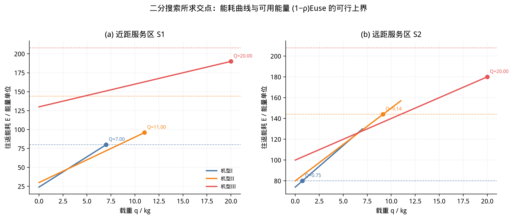
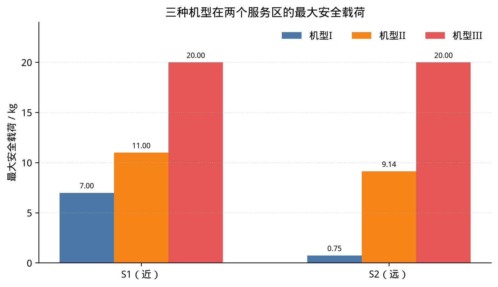
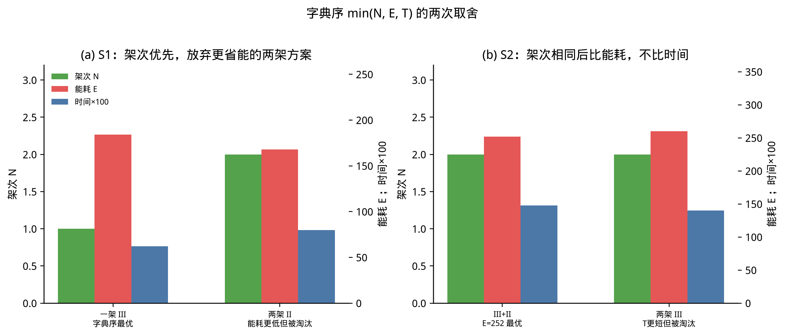
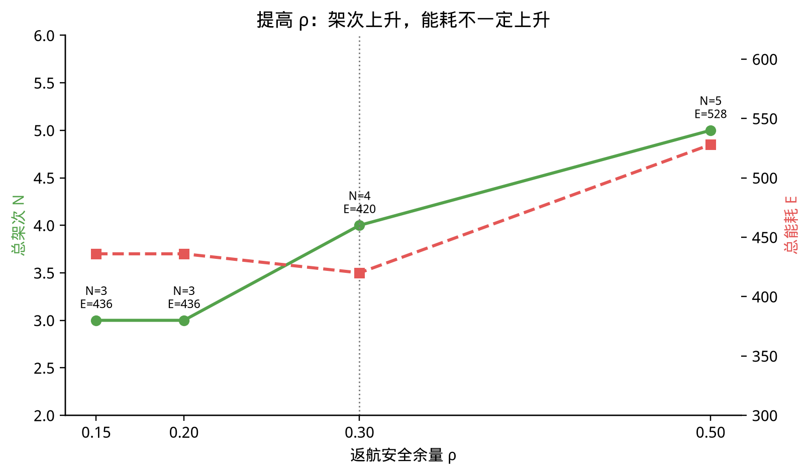

# 问题一：单点往返运输能力与货箱组批

问题一在“单服务区、单架次、直接往返”条件下，评估三种运输无人机的基础运输能力。不考虑实体无人机编号和共享电池周转，每个架次都是 `O01 → Sᵢ → O01`。全题按“由简到繁、由局部到全局”推进，本问给出各服务区的载荷上界、货箱组批和指标优先关系，供后续多点调度使用。

本目录中的数值是一组参数全部公开的核验算例，用来把求解过程算到可以手算复核的程度。能耗取线性形式 \(E=a+bq\)，只为了能逐项核对；真实模型只要随载重单调增加，三步算法的结构不变。镇龙乡附件中的正式载荷、批次和能耗，以 `problem1_v1_output` 为准。

## 要求

1. 货箱不可拆分，每箱只能安排一次，并同时满足载质量、装载体积和返航安全能量余量，确定各服务区的货箱组批方案。
2. 在完成全部货箱交付的前提下，综合考虑往返架次数、总运输能耗和累计作业时间，对组批方案优化，并说明三个指标的优先关系。
3. 讨论返航安全余量变化对不同机型最大安全载荷和货箱组批结果的影响。

## 求解方法

| 阶段 | 方法 | 作用 |
| --- | --- | --- |
| 最大安全载荷 | 二分搜索 | 求各机型在各服务区的最大安全载荷 |
| 货箱组批 | 集合划分 + 状态压缩动态规划 | 求各服务区货箱组合及执行机型的全局最优 |
| 多目标取舍 | 字典序优化 | 依次最小化架次数、总能耗、累计作业时间 |

针对问题一，先用二分搜索求解不同机型在各服务区的最大安全载荷；再建立载重、体积与能量约束下的集合划分模型，用状态压缩动态规划精确求解；最后按字典序依次最小化运输架次数、总运输能耗和累计作业时间。改变返航安全余量后，三步全部重做。

### 1. 二分搜索

机型 \(g\) 前往服务区 \(i\) 时，去程载重为 \(q\)，回程按空载计算。往返能耗

\[
E_{gi}^{RT}(q)=E_{gi}^{\mathrm{go}}(q)+E_{gi}^{\mathrm{back}}(0)+E_{gi}^{\mathrm{hover}}
\]

随 \(q\) 单调不减，这是二分搜索成立的前提。返航安全余量为 \(\rho_g\) 时，可用能量只剩 \((1-\rho_g)E_g^{\mathrm{use}}\)：

\[
E_{gi}^{RT}(q)\le(1-\rho_g)E_g^{\mathrm{use}},\qquad 0\le q\le M_g.
\]

最大安全载荷是满足上式的最大质量。搜索区间取 \([0,M_g]\)。中点可行就把下界抬到中点，不可行就把上界压到中点。返回值必须是仍然可行的下界，不能返回最后一个中点。

三种退出情形要分开记录：

- 空载往返已经超过可用能量：该机型不可达，上界为 0。
- 满载仍满足能量约束：上界等于额定载质量，能量约束没有收紧。
- 空载可行、满载不可行：上界落在区间内部，由能量约束绑定。只有这种格子对 \(\rho\) 敏感。

体积不进入二分搜索。质量上界只说明“这一趟最多多重”，不说明“这几箱体积能否装进同一舱”。

这一步需要 O01 与各服务区的坐标和高程、三种机型的可用能量、额定载质量、安全余量、速度和分阶段能耗系数，以及 DEM 给出的爬升量和下降量。输出是“机型 × 服务区”的载荷上界表，并标明上界来自能量还是额定载重。

### 2. 集合划分与状态压缩动态规划

每个服务区单独做集合划分。服务区 \(i\) 的货箱集合为 \(J_i\)。一个候选批次是子集 \(S\subseteq J_i\) 再加一种机型 \(g\)，并且

\[
\sum_{j\in S}m_j\le Q_{gi}^{\max},\qquad \sum_{j\in S}v_j\le V_g,\qquad S\neq\varnothing.
\]

第一条已经包含能量约束。同一子集若有多种机型都能飞，只保留能耗更低、能耗相同时时间更短的一种。被删掉的是同一子集上的劣势机型；不删也不会改变最优值，动态规划会在转移时丢掉它们。

用 \(n_i\) 位二进制表示分配状态，第 \(j\) 位为 1 表示货箱 \(j\) 已经装入某个批次。\(dp(x)=(N,E,T)\) 是覆盖集合 \(x\) 的字典序最优代价。

\[
dp(\varnothing)=(0,0,0).
\]

对已求得最优代价的状态 \(x\)，枚举与它不相交的候选批次，用

\[
dp(x)\oplus\bigl(1,\ E_{gi}^{RT}(q_S),\ T_{gi}(q_S)\bigr)
\]

更新新状态，并按字典序比较。掩码从小到大扫描时，任一子集的掩码都更小，因此读到 \(x\) 时它的最优代价已经固定。

三个分量都能相加，字典序具有最优子结构：同一集合上更优的代价，接上同一批次后仍然更优；更大集合的最优划分去掉最后一批后，剩下的子集也必须是该子集的最优。所以每个掩码只保留一个最优值，得到的是该模型的精确解，不是首次适应或贪心组批的近似解。

服务区货箱数不大时才适合直接枚举子集。80 个货箱是 15 个服务区分别求解后的总和，不是对 80 箱做一次 \(2^{80}\) 搜索。

回溯时记录每个状态的最后一批，从全 1 掩码反推批次清单。每个服务区要导出：货箱编号、机型、实际载重、体积、该架能耗和作业时间，以及质量利用率、体积利用率。

### 3. 字典序

\[
\min_{\mathrm{lex}}(N,E,T).
\]

先比架次数，架次数相同再比总能耗，前两项都相同再比累计作业时间。问题一按串行累计口径计时，不把多机并行提前放进来。时间放在第三位，是因为本问先评价运输批次能力；问题二以后有了时限和多机并行，优先顺序可以再改。

\(N\)、\(E\)、\(T\) 都能按服务区相加，所以各服务区分别取字典序最优再求和，就是全局字典序最优。不需要把 15 个服务区的方案做笛卡尔积。字典序比较发生在每一次状态更新里，不是事后再从启发式方案里挑选。

## 核验算例

### 输入

三种机型，基准余量 \(\rho=0.20\)。

| 机型 | \(E^{\mathrm{use}}\) | 可用能量 | 额定载质量 | 容积 | S1 单架时间 | S2 单架时间 |
| --- | ---: | ---: | ---: | ---: | ---: | ---: |
| I | 100 | 80 | 7 | 8 | 0.32 | 0.95 |
| II | 180 | 144 | 11 | 16 | 0.40 | 0.78 |
| III | 260 | 208 | 20 | 22 | 0.62 | 0.70 |

往返能耗 \(E=a+bq\)：

| 服务区 | 机型 I | 机型 II | 机型 III |
| --- | --- | --- | --- |
| S1（近） | \(24+8q\) | \(30+6q\) | \(130+3q\) |
| S2（远） | \(74+8q\) | \(80+7q\) | \(100+4q\) |

| 服务区 | 货箱（质量 kg，体积） |
| --- | --- |
| S1 | P1(6, 5)，P2(5, 4)，P3(4, 6)，P4(3, 3)。合计质量 18，体积 18 |
| S2 | R1(6, 9)，R2(5, 8)，R3(4, 7)。合计质量 15，体积 24 |

### 最大安全载荷

机型 II 在 S2 上的闭式解是 \((144-80)/7=9.142857\)。精度只取 0.05 时，八步搜索得到的可行下界是 9.109，低于真值。正式计算的精度必须远小于最小货箱质量差，否则会把刚好跨过上界的批次误判为不可行。

| 服务区 | 机型 I | 机型 II | 机型 III | 绑定情况 |
| --- | ---: | ---: | ---: | --- |
| S1 | 7.00 | 11.00 | 20.00 | 三者都由额定载重封顶。机型 I 满载能耗刚好等于 80，能量同时触顶 |
| S2 | 0.75 | 9.14 | 20.00 | I、II 由能量卡住。机型 I 连 4 kg 的最轻货箱也带不走；III 仍是额定载重 |

图中虚线是各机型自己的可用能量，不能拿一条曲线去对另一种颜色的虚线。S1 上三条曲线在额定载重处都还没有越过各自的虚线，标记打在右端点。S2 上机型 I 几乎一离开原点就越过虚线，机型 II 的标记在曲线与虚线的交点。

### 候选批次

S2 的三箱合装：质量 15 ≤ 20，能耗 \(100+4\times15=160\le208\)，体积 24 > 22。质量和能量都通过，体积单独把这一批删掉。这就是体积不能写进二分搜索的原因。

机型 II 可以飞 \(\{R2,R3\}\)（质量 9 ≤ 9.14，体积 15 ≤ 16，能耗 143）。同一子集用机型 III 只要 136，时间也更短，候选里只留 III。若程序没有做这步剪枝，动态规划仍应得到 252，而不是用劣势机型算出的 265。

S1 剪枝后的候选：

| 子集 | 机型 | 质量/上界 | 体积/容积 | 能耗 | 时间 |
| --- | --- | ---: | ---: | ---: | ---: |
| {P4} | I | 3/7 | 3/8 | 48 | 0.32 |
| {P1,P2} | II | 11/11 | 9/16 | 96 | 0.40 |
| {P3,P4} | II | 7/11 | 9/16 | 72 | 0.40 |
| {P1,P2,P3,P4} | III | 18/20 | 18/22 | 184 | 0.62 |

{P4} 是一条边界。机型 I 和 II 的能耗都是 48，I 的时间 0.32 更短，所以留下 I。若状态表里这一箱的时间是 0.40，就是同能耗时没有比较时间。它没有进入最终批次，只影响中间状态。

### 动态规划结果

S1 覆盖全部四箱的最优状态是 \((N,E,T)=(1,184,0.62)\)，四箱同乘机型 III。质量利用率 \(18/20\)，体积利用率 \(18/22\)。

两架 II 的方案 \(\{P1,P2\}+\{P3,P4\}\) 能耗是 \(96+72=168\)，时间 0.80。它转移到全覆盖状态时被拒绝，因为架次 2 大于 1。动态规划表里看不到 168，不代表这组方案不可行。

S2 的最优状态是 \((2,252,1.48)\)：\(\{R1,R2\}\) 乘 III，\(\{R3\}\) 乘 II。顺序对调的路径代价相同。\(\{R1,R3\}+\{R2\}\) 的能耗是 255，三架全单飞是 345。

两个服务区相加：

\[
(1+2,\ 184+252,\ 0.62+1.48)=(3,\ 436,\ 2.10).
\]

### 字典序取舍

| 对照 | 保留的方案 | 被拒绝的方案 | 拒绝原因 |
| --- | --- | --- | --- |
| S1 | 一架 III：(1, 184, 0.62) | 两架 II：(2, 168, 0.80) | 能耗少 16，但架次多 1 |
| S2 | III+II：(2, 252, 1.48) | 两架 III：(2, 260, 1.40) | 架次相同，时间更短但能耗高 8 |

若把第一关键字改成能耗，S1 会改选两架 II，全局变成 \((4,420,2.28)\)。这是另一种目标下的解，不是 \(\rho=0.20\) 的字典序解。S2 上第三关键字没有发生作用：时间更短的方案先在能耗上被淘汰。

图中蓝色柱是时间乘 100，只为了和能耗放在同一数量级。实际时间是 0.62、0.80、1.48 和 1.40。

## 结果分析

近距服务区 S1 的三种机型都由额定载重封顶，航程短、固定能耗低，大机型有能力把 18 kg 一次带走。远距服务区 S2 的机型 I、II 被能量卡住，机型 I 的上界只有 0.75 kg，实际上退出该服务区的运输。同一机型在不同服务区的载荷差，来自航迹固定能耗占可用能量的比例，不是来自货箱本身。

组批结果和这条差异一致。S1 用一架 III 完成，质量和体积都还没有顶满。S2 不能三箱合装，限制来自体积 24 > 22，而不是来自 20 kg 的质量上界。最终是一架 III 带两箱、一架 II 带最轻的一箱。只看质量上界，会误以为三箱可以同舱。

字典序把架次放在能耗前面，所以 S1 接受了能耗更高的一架方案。两架 II 更省能，但多一次往返。应急场景下这个顺序是可解释的：先压缩往返次数，架次已经不能再少时才节约能量。S2 则说明，架次相同之后比的是能耗，不是时间。论文里需要保留这两个被淘汰方案，否则看不出字典序和加权求和的差别。

线性能耗还有一个不能误读的性质：同一机型、相同架次数下，不同分箱的总能耗相同，因为总能耗等于“架次数 × 固定能耗 + 能耗系数 × 总质量”。因此 \(\rho=0.50\) 时 S1 的分箱从 \(\{P1,P2\}+\{P3,P4\}\) 改成 \(\{P1,P3\}+\{P2,P4\}\)，\((N,E,T)\) 仍是 \((2,168,0.80)\)。只汇报三个汇总指标，会漏掉这次重组。真实能耗若随载重非线性变化，同架次的不同分箱能耗不再相同，动态规划必须按每个子集单独计算能耗；算法结构不用改。

## 安全余量

\(\rho\) 改变后，可用能量、载荷上界、候选批次和动态规划都要重算，不能在原方案的能耗上乘一个系数。

| \(\rho\) | S1 | S2 | 合计 \((N,E,T)\) |
| ---: | --- | --- | --- |
| 0.15 | 四箱 III，(1, 184, 0.62) | 与基准相同，(2, 252, 1.48) | (3, 436, 2.10) |
| 0.20 | 同上 | 同上。II 的上界降到 9.14，但最优批次没有用到刚被卡掉的组合 | (3, 436, 2.10) |
| 0.30 | 改为两架 II，(2, 168, 0.80) | 仍是 (2, 252, 1.48) | (4, 420, 2.28) |
| 0.50 | 仍是两架 II，但 11 kg 的一批不再可行，分箱重组 | 三箱分别由 III 单飞，(3, 360, 2.10) | (5, 528, 2.90) |

\(\rho=0.30\) 时，III 在 S1 的能量上界降到 17.33 kg，四箱 18 kg 越界，一架方案消失。总架次从 3 增到 4，总能耗却从 436 降到 420。余量变严不一定更耗能：它把固定能耗很高的大机型一架方案剔掉了，字典序只好接受架次更多、巡航更省的方案。

\(\rho=0.50\) 时，S2 上所有两箱组合的质量都不低于 9 kg，III 的上界只剩 7.5 kg，两箱批次全部消失，架次从 2 跳到 3。架次是整数，敏感性曲线会在可行批次消失的位置出现台阶，不应画成直线。

\(\rho=0.15\) 时，S2 上机型 II 的上界升到 10.43 kg，多出一组可行批次，但能耗不如原来的 252，最优方案不动。可行域变大，不等于最优值改变。

## 和程序结果对照

正式输出至少包括五样：载荷上界表及约束来源、能耗—载荷曲线、各服务区批次明细、被字典序淘汰的对照方案、\(\rho\) 对载荷和架次的敏感性表。

若 S2 的机型 II 上界约为 9.14，三箱候选却仍然存在，就是没有检查体积，或把体积写进了质量上界。若全覆盖代价是 (2, 265) 或 (2, 260)，前者用了劣势机型，后者是架次相同后去最小化时间。若 S1 的最优代价是 (2, 168) 而不是 (1, 184)，第一关键字被换成了能耗。若 \(\rho\) 从 0.20 增到 0.30 时总能耗不降反升，就是没有重跑组批，只把原架次的能耗放大了。
